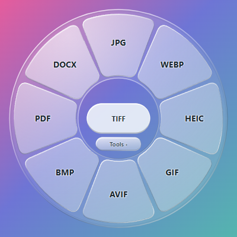

# Sift

Sift 0.3 is an offline file converter that stays in the Windows notification area or macOS menu bar. Its circular wheel and compact editors appear when needed. It is an independent, original implementation inspired by [Tangerine](https://www.tangerineformac.com/). **No API keys, accounts, Node.js installation or conversion server are needed to use a packaged app.**

*Sift 0.3.1, captured over a test background. Hold Shift while dragging for formats; use Tools for compression, cropping and other image actions.*

## Download and install

Get Sift from **[GitHub Releases](https://github.com/Yash789k/Sift/releases)**. Open the newest prerelease and expand **Assets**.

| Your computer | Download |
|---|---|
| Mac with an Apple chip (M1, M2, M3, M4 or newer), macOS 13+ | [Download for Apple Silicon (.dmg)](https://github.com/Yash789k/Sift/releases/download/v0.3.2/Sift-0.3.2-macos-arm64.dmg) |
| Windows 11 PC with an Intel or AMD 64-bit processor | [Download for Windows (.exe)](https://github.com/Yash789k/Sift/releases/download/v0.3.2/Sift-0.3.2-windows-x64-setup.exe) |

You need **only the installer for your computer**. Node.js, Electron and the conversion tools are already included. You do not need Git, Terminal commands, an account or an API key. The **Source code** and **Corresponding source** downloads are for developers, not installation. Native Windows ARM and Intel Mac installers are not part of this first prerelease.

The first release is an **unsigned prerelease**: a test version whose publisher has not been verified by Apple or Microsoft. Expect a first-open security warning. Read the release notes before installing, and only approve a file you downloaded from this repository. [Step-by-step instructions and warning help →](docs/INSTALLATION.md)

### Mac with Apple Silicon

1. Download the `.dmg` file above and double-click it.
2. Drag **Sift** onto **Applications** in the window that appears.
3. Eject the Sift disk, then open **Applications → Sift**.
4. Look for Sift in the **menu bar at the top of your screen**. It does not keep a Dock icon or a large window open.
5. Click its menu-bar icon → **Convert files…**, choose a file, then choose an output format.

For the optional drag shortcuts, open Sift **Settings → Open shortcut access…**, enable Sift in **System Settings → Privacy & Security → Input Monitoring**, then quit and reopen Sift. You can use **Convert files…** without this permission.

### Windows 11

1. Download the `.exe` file above and double-click it.
2. Let the installer finish. It installs for your Windows account and opens Sift.
3. Find Sift in the **notification area beside the clock**. Click the hidden-icons arrow if needed.
4. Open Sift's icon menu → **Convert files…**, choose a file, then choose an output format.

A **Sift** shortcut is added to Start. You do not need to open a console or run the installer as administrator. **Launch at login** starts off; enable it in Sift's settings if you want it.

## Use Sift

- **Convert files…** chooses files and opens the format wheel. In an open wheel, **Ctrl+O / Command+O** also chooses files.
- Drag files from Explorer/Desktop on Windows or Finder on macOS, hold **Shift**, and drop on a format. Hold **Alt** on Windows or **Command** on macOS for tools.
- Click **Tools ›** in the center well for Crop, Add BG and the other image tools; **Formats ›** returns to conversion. **Tab** or right-click also switches. The switch preserves selected files.
- Successful conversions and tool saves close the wheel/editor automatically. A small **Show** notification stays available for two seconds, then fades away. Failures and partial results remain available to review; saved results are also in **Current jobs…**.
- The wheel has a transparent center around its controls, clear glass petals and an orange selection that deepens toward the outside. Moving between available wheel controls plays a quiet local click.
- **Current jobs…** shows progress, cancellation, errors and saved results. Closing a window leaves the background utility running; use **Quit Sift** to exit.
- **Ctrl+Alt+Space / Command+Option+Space** opens the wheel manually. Arrow keys navigate its controls; **Enter** or **Space** activates the focused control. **Escape** cancels an active wheel operation, returns from an editor or hides the wheel.

Outputs save **beside each original**. Existing names get suffixes and originals are preserved. Settings can choose a destination or restore **Use original folder**. **Open output folder** and result links reveal saved files.

Windows saves notify Explorer. For Desktop sources, including a redirected OneDrive Desktop, a helper also tries a free icon position near the original without moving other icons or changing Auto arrange/Hide icons settings. If Windows controls placement or no slot is available, the output remains saved. Finder handles macOS icons normally.

Windows physical file drag and source-adjacent conversion were user-verified in the previous wheel build. The source guard excludes browser/text/dialog drags and window move/resize loops. Explorer marquee selection may still briefly open a wheel when a modifier is held; no conversion occurs without a file drop or explicit selection. The new lazy startup path has automated desktop coverage; a fresh physical drag check on each release remains part of platform acceptance.

## Update or remove

There is **no automatic updater**. Quit Sift, then run the newer Windows installer, or replace the app in Applications from a newer Mac DMG. Keep the application name/ID and the Windows account unchanged to retain settings. The installer preserves opt-in login registration during upgrades.

On Windows, use **Settings → Apps → Installed apps → Sift → Uninstall**. Removal deletes the installed application and its Sift login registration. On macOS, turn off **Launch at login** in Sift, quit it, then move **Sift.app** from Applications to Trash. Check macOS Login Items if removing an app that no longer launches.

Converted files are retained. Preferences, local logs and recent output records are retained too, at `%APPDATA%\Sift` on Windows or `~/Library/Application Support/Sift` on macOS. Remove that specific folder only if you also want to erase Sift's local state.

## Formats

| Input | Output |
|---|---|
| PNG, JPG/JPEG, WebP, AVIF, TIFF, GIF, SVG, BMP, HEIC/HEIF | PNG, JPG, WebP, HEIC, GIF, AVIF, BMP, TIFF, PDF, DOCX |
| PDF | One PNG/JPG per page, TXT, DOCX |
| MP3, WAV, M4A, AAC, FLAC, OGG, Opus, AIF/AIFF | MP3, WAV, M4A, FLAC, OGG |
| MP4, MOV, M4V, WebM, MKV, AVI, MPEG/MPG, WMV | MP4, WebM, GIF; extract MP3/WAV/M4A audio |

The image wheel omits the source format. A JPEG shows PNG/WEBP/HEIC/GIF/AVIF/BMP/PDF/DOCX around TIFF; a PNG exposes JPG instead of PNG, and a TIFF uses DOCX at the center. PDF has four wedges. The engine also supports image-to-multipage-PDF creation and PDF merging; capability coverage does not imply every engine option has a separate wheel control.

HEIC encoding is real local WebAssembly, with a fixed balanced quality preset and white matte for transparency. Image-to-DOCX embeds an image; it does not recognize text. PDF-to-DOCX extracts editable text with reflowed layout and embeds image-only pages; PDF-to-TXT requires selectable text. **No OCR, layout-perfect PDF-to-Word, camera RAW or archive conversion is claimed.**

PDF image export uses 144 dpi bounded to 20 megapixels per page. Encrypted PDFs are unsupported. Input extensions identify a category; unusual codecs or damaged files may fail. Up to 100 files per batch, 100-megapixel image inputs and 250 MiB per PDF are allowed.

## Image tools

| Tool | Operation |
|---|---|
| Crop | Drag handles, enter dimensions, or use Free, 1:1, 16:9, 9:16, 4:3 or 3:4 |
| Add BG | Preset/color background, padding, corners, shadow and aspect ratio |
| Compress | Quality and longest-edge limit in pixels, with a real preview |
| Metadata | Inspect embedded metadata; create a metadata-removed copy |
| Edit | Resize, rotate, flip, brightness and saturation |
| Annotate | Text, color, font size and position |
| Redact | Solid or blurred rectangular area |

Editors operate on the first frame/page. Supported GIF/WebP conversion can preserve animation; static outputs and applicable transforms report first-frame behavior. Metadata removal re-encodes a copy and can change file size; it is not a file-timestamp editor. Compression may not make an already efficient input smaller. Successful files remain when a later batch item fails or is cancelled.

## Local state and privacy

Preferences, recent output records and bounded diagnostic logs stay in Electron's user-data directory. History and errors can include file locations; review them before sharing a bug report and exclude them from source archives. Settings offers **Open local logs**. The `--demo` flag uses separate demonstration state.

Native detection reads modifier/button state and pointer location. Windows reads source-window class and Explorer selection context; macOS checks the file drag pasteboard. Files are not uploaded. Bounded local gesture diagnostics record transition events, not typed text, filenames, window titles or pointer coordinates. Disable **Drag shortcuts** or quit Sift to stop detection.

## For developers

Users should install a download from Releases. To change Sift, run tests, or build your own installer, follow [CONTRIBUTING.md](CONTRIBUTING.md). Maintainers can find the build, signing and release process in [DISTRIBUTION.md](DISTRIBUTION.md).

## License and publishing

Original Sift source and project-created assets are **GPL-3.0-or-later**: [LICENSE](LICENSE). Dependencies retain their own licenses: [THIRD_PARTY_NOTICES.md](THIRD_PARTY_NOTICES.md). See [CONTRIBUTING.md](CONTRIBUTING.md) for development and testing.

Installer releases include the bundled runtime and converters. Matching source, build recipes, checksums and license notices accompany each public binary release as described in [DISTRIBUTION.md](DISTRIBUTION.md). No automatic updater is included.
